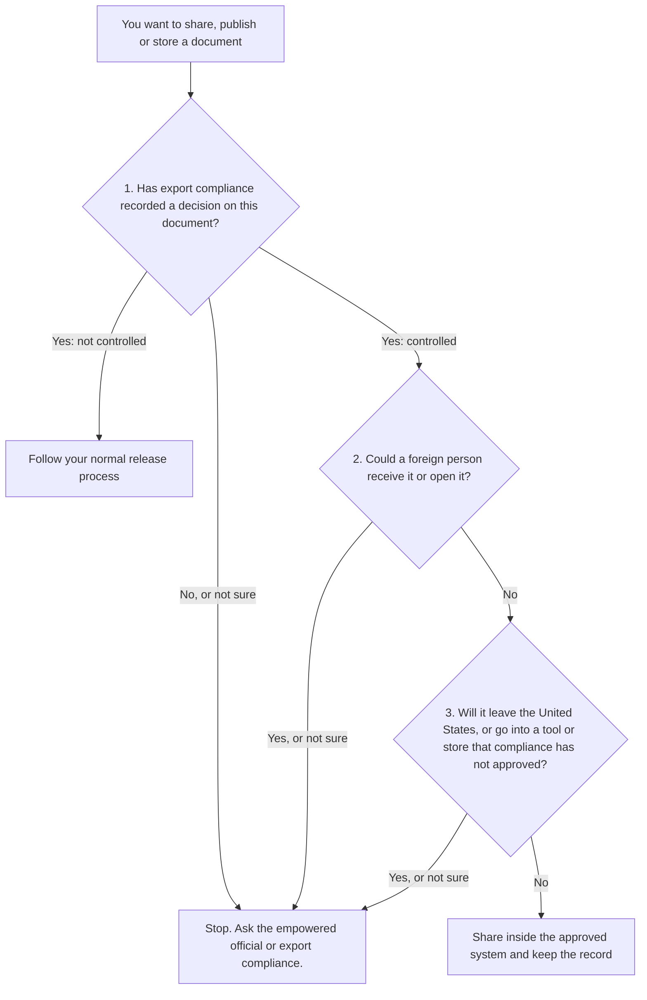

import AboutSample from '@site/src/components/AboutSample';

<AboutSample
  roles={['Regulated product documentation']}
  audience="Technical writers and documentation managers at a US manufacturer whose documents may contain export-controlled information. They are not export specialists."
  goal="Help a writer recognize the moments that need a check with the empowered official or export compliance team, before a document is shared, published or stored."
  constraints="Every statement of what the regulations say is tied to a section. Only primary sources. Generic throughout: no real program, product, company or controlled content. Not legal advice. Current as of the date on the page."
  tools="Markdown, Docusaurus, Mermaid, eCFR and the Federal Register as sources, Vale.">

- **Built as a decision guide, not a summary of the regulations.** A writer's question is "can I send this?", so the page leads with a flowchart that ends in "share" or "stop and ask".
- **Each branch of the flowchart points to a definition.** The table under the chart names the section behind each question, so a reviewer can check the logic one branch at a time.
- **The two regimes sit side by side in tables.** The terms differ in small ways that matter. A table shows the differences without asking the reader to hold two paragraphs in mind.
- **Law and practice are labeled separately.** Marking and the "writer's day" section are common practice, and the page says so.
- **The page never tells a writer how to classify a document.** That decision belongs to export compliance, and a guide that hinted otherwise would be a risk.

</AboutSample>

:::caution Writing sample, not legal advice
This page is a writing sample. It summarizes federal regulations in plain language and leaves out detail, including licenses and exemptions. It is not legal advice. Your company's export compliance team decides how these rules apply to a document.

**Checked against the regulation text on November 10, 2026.**
:::

## The short version

Two sets of US regulations control who may receive certain technical information. A document can be "exported" without leaving the building.

**You do not decide whether a document is controlled. Your export compliance function does.** Your job is to know when to stop and ask.

## Two regimes

| | ITAR | EAR |
| --- | --- | --- |
| Full name | International Traffic in Arms Regulations | Export Administration Regulations |
| Where | [22 CFR Parts 120 to 130](https://www.ecfr.gov/current/title-22/chapter-I/subchapter-M) | [15 CFR chapter VII, subchapter C](https://www.ecfr.gov/current/title-15/subtitle-B/chapter-VII/subchapter-C) (Parts 730 to 774) |
| Who administers it | Department of State, Directorate of Defense Trade Controls (DDTC) ([§ 120.1](https://www.ecfr.gov/current/title-22/section-120.1)) | Department of Commerce, Bureau of Industry and Security (BIS) ([§ 730.1](https://www.ecfr.gov/current/title-15/section-730.1)) |
| What it covers | Defense articles and defense services on the U.S. Munitions List ([§ 120.2](https://www.ecfr.gov/current/title-22/section-120.2)) | Items "subject to the EAR". Items controlled only under the ITAR are excluded ([§ 734.3](https://www.ecfr.gov/current/title-15/section-734.3)) |
| Term for controlled information | Technical data | Technology |

**What this changes in your work:** which regime applies to a product, and to the documents about it, is a jurisdiction and classification decision. The government offers formal routes for doubtful cases ([22 CFR 120.4](https://www.ecfr.gov/current/title-22/section-120.4); [15 CFR 748.3](https://www.ecfr.gov/current/title-15/section-748.3)). Your company's export compliance function uses them, not the writer.

## Before you share a document

| Question | Definition behind it |
| --- | --- |
| 1. Is it controlled? | "Technical data" ([22 CFR 120.33](https://www.ecfr.gov/current/title-22/section-120.33)), "technology" ([15 CFR 772.1](https://www.ecfr.gov/current/title-15/section-772.1)), "public domain" ([22 CFR 120.34](https://www.ecfr.gov/current/title-22/section-120.34)), "published" ([15 CFR 734.7](https://www.ecfr.gov/current/title-15/section-734.7)) |
| 2. Could a foreign person receive it? | "Foreign person" ([22 CFR 120.63](https://www.ecfr.gov/current/title-22/section-120.63); [15 CFR 772.1](https://www.ecfr.gov/current/title-15/section-772.1)), "release" ([22 CFR 120.56](https://www.ecfr.gov/current/title-22/section-120.56); [15 CFR 734.15](https://www.ecfr.gov/current/title-15/section-734.15)), deemed export ([22 CFR 120.50(a)(2)](https://www.ecfr.gov/current/title-22/section-120.50); [15 CFR 734.13(a)(2)](https://www.ecfr.gov/current/title-15/section-734.13)) |
| 3. Will it leave the United States or an approved system? | "Export" ([22 CFR 120.50(a)(1)](https://www.ecfr.gov/current/title-22/section-120.50); [15 CFR 734.13(a)(1)](https://www.ecfr.gov/current/title-15/section-734.13)), activities that are not exports ([22 CFR 120.54](https://www.ecfr.gov/current/title-22/section-120.54); [15 CFR 734.18](https://www.ecfr.gov/current/title-15/section-734.18)) |

"Stop" does not mean "no". A license or exemption may allow the transfer. Applying one is the compliance team's work.

## The definitions behind the chart

### Controlled information

| | ITAR "technical data" (§ 120.33) | EAR "technology" (§ 772.1) |
| --- | --- | --- |
| Core meaning | Information required for the design, development, production, manufacture, assembly, operation, repair, testing, maintenance or modification of defense articles | Information necessary for the development, production, use, operation, installation, maintenance, repair, overhaul or refurbishing of an item |
| Forms named | Blueprints, drawings, photographs, plans, instructions, documentation | Any tangible or intangible form, including written or oral communications, drawings, photographs, diagrams, specifications, manuals and information revealed by visual inspection |
| Left out | General scientific, mathematical or engineering principles commonly taught in schools; information in the public domain; basic marketing information on function or purpose; general system descriptions | Published information and other categories listed in [§ 734.3(b)(3)](https://www.ecfr.gov/current/title-15/section-734.3) |

**What this changes in your work:** manuals, work instructions and maintenance procedures are the kinds of documents these definitions name. Applying an exclusion is a classification decision. Do not make it yourself.

### Export, release and the deemed export

Under both regimes, "export" includes sending something out of the United States, and releasing controlled information to a foreign person inside the United States. The regulations call the second case a **deemed export** (22 CFR 120.50(a)(2); 15 CFR 734.13(a)(2)).

A release can be oral, written or visual (22 CFR 120.56(a); 15 CFR 734.15(a)). Under the ITAR, it also includes using "access information", such as a decryption key or password, to cause or enable a foreign person to access unencrypted technical data (§ 120.55; § 120.56(a)(3)). The EAR addresses access information at 15 CFR 734.15(b).

Transferring technical data to a U.S. person in the United States from a person in the United States is not an export (22 CFR 120.54(a)(2)).

### U.S. person and foreign person

Under the ITAR, a U.S. person is a lawful permanent resident or a "protected individual" under 8 U.S.C. 1324b(a)(3), a category that includes US citizens. US-incorporated entities and US government bodies also count ([§ 120.62](https://www.ecfr.gov/current/title-22/section-120.62)). A foreign person is any natural person who is neither, and any entity not incorporated or organized to do business in the United States. International organizations and foreign governments are also foreign persons (§ 120.63).

**What this changes in your work:** for a natural person, the definitions in § 120.62 and § 120.63 turn on citizenship and immigration status, not on an employer, a job title or a signed confidentiality agreement. You cannot tell someone's status from a name or a location, so ask compliance who is cleared for a document.

### Public domain and published

ITAR "public domain" means information that is published and generally available to the public through one of the listed routes, such as bookstores, public libraries, patents or open conferences in the United States (§ 120.34(a)). One route is public release "after approval by the cognizant U.S. Government department or agency" (§ 120.34(a)(7)). The list does not name posting to a website.

EAR "published" is worded differently. Unclassified technology or software is published when it has been "made available to the public without restrictions upon its further dissemination". The examples include "posting on the Internet on sites available to the public" (§ 734.7(a)(4)). Paragraphs (b) and (c) of § 734.7 list exceptions.

**Why publishing is not your decision.** Under the ITAR, the public release route applies "after approval by the cognizant U.S. Government department or agency" (§ 120.34(a)(7)), and exporting technical data without a required license or written approval is unlawful ([§ 127.1(a)(1)](https://www.ecfr.gov/current/title-22/section-127.1)). The EAR text describes when information is published. It does not say who inside a company may publish it. Practical reading, not a statement of law: treat an EAR release as a question of who at your company has authority to release information, and ask export compliance before you make anything public.

### The encryption carve-out

Both regimes say that sending, taking or storing controlled information is not an export when every listed condition is met (22 CFR 120.54(a)(5); 15 CFR 734.18(a)(5)). Encryption alone is not enough. In brief, the conditions are:

- The information is unclassified.
- It is secured using end-to-end encryption. This means the data is not in unencrypted form between the originator and the intended recipient, or their in-country security boundaries, and the means of decryption are not provided to any third party (22 CFR 120.54(b)(1); 15 CFR 734.18(b)).
- It is secured using cryptographic modules compliant with FIPS 140-2 or its successors, supplemented by procedures and controls in accordance with current NIST guidance. Each rule also names an alternative: under the ITAR, other cryptographic means with security strength "at least comparable to the minimum 128 bits of security strength achieved by the Advanced Encryption Standard (AES-128)"; under the EAR, "other equally or more effective cryptographic means".
- Location limits apply. Under the ITAR, the data is not intentionally sent to a person in, or stored in, a country proscribed in 22 CFR 126.1, and is not sent from such a country. Under the EAR, the data is not intentionally stored in a Country Group D:5 country. Both rules have a note on data in transit over the internet.
- Under the ITAR, the intended recipient must be the originator, a U.S. person in the United States, or a person otherwise authorized to receive the technical data (§ 120.54(b)(2)).

Whether a specific tool or setup meets every condition is a compliance decision. Do not make it yourself.

## Marking and recordkeeping

**Marking is treated here as company practice.** This review did not find a section of either regulation that requires an export-control legend on every controlled technical document. That is a limit of this review, not a legal conclusion. Many companies require a legend in their own procedures, and your company's procedure governs. The regulations do require a destination control statement on the commercial invoice for certain shipments in tangible form ([22 CFR 123.9(b)](https://www.ecfr.gov/current/title-22/section-123.9); [15 CFR 758.6](https://www.ecfr.gov/current/title-15/section-758.6)). A missing marking never means a document is uncontrolled.

**Records are a rule requirement.** ITAR registrants must keep records about technical data and exports for five years from the expiration of the license or other approval, or from the date of the transaction ([22 CFR 122.5(a)](https://www.ecfr.gov/current/title-22/section-122.5)). Records required by the EAR must be kept for five years from the latest of several events listed in [15 CFR 762.6(a)](https://www.ecfr.gov/current/title-15/section-762.6).

**What this changes in your work:** distribution lists, review records and transmittals may be compliance records. Ask before you delete them.

## What is at stake

A willful violation of 22 U.S.C. 2778 (part of the Arms Export Control Act) or of the regulations issued under it carries a fine of up to $1,000,000 per violation, up to 20 years in prison, or both ([22 U.S.C. 2778(c)](https://www.law.cornell.edu/uscode/text/22/2778)). Subsection (e) of the same statute lets the Secretary of State assess civil penalties. The ITAR civil maximum is the greater of $1,271,078 or twice the value of the transaction, per violation ([22 CFR 127.10(a)(1)(i)](https://www.ecfr.gov/current/title-22/section-127.10)). For the EAR, the criminal maximum is $1,000,000 and, for an individual, 20 years ([50 U.S.C. 4819(b)](https://www.law.cornell.edu/uscode/text/50/4819)). The civil maximum is $300,000 or twice the transaction value, whichever is greater (50 U.S.C. 4819(c)); the $300,000 figure is adjusted to $374,474 ([15 CFR 6.3(c)(6)](https://www.ecfr.gov/current/title-15/section-6.3)). Civil figures are adjusted for inflation and were checked on November 10, 2026.

## What this changes in a writer's day

This section is practical reading, not a statement of law. Your company's procedures take priority.

| Situation | Habit |
| --- | --- |
| Drafts | Treat a draft like the final document. Source files, review PDFs and backups all count. |
| Review cycles | Before you send a review copy to a vendor or colleague, or share your screen, confirm that compliance has cleared each person for that document. A foreign-national colleague at the next desk is still a deemed-export question. |
| Screenshots and photos | A photo of hardware, a screen capture or a cropped drawing can carry the same information as the source. Treat it the same way. |
| Cloud tools | Use only the storage, authoring and translation tools that your company has approved for controlled content. A convenient tool is not an approved tool. |
| AI tools | Pasting text into an AI assistant sends it to someone else's system. Do not do it with controlled content unless compliance has approved that tool for that content. |
| Portfolio samples | Never reuse controlled content as a writing sample, even with names removed. Write a fictional sample that shows the same skill. |

## Questions to ask before you press send

A "not sure" on any of these means stop and ask.

1. Has export compliance recorded a decision on this document, and do I know what it is?
2. Do I know who will receive it, and who else can open the place where I am putting it?
3. Has compliance cleared each of those people for this document?
4. Is the tool or storage location approved for this content?
5. If this is going outside the company, who approved the release?

## Sources

All statements about what the regulations say come from these primary sources.

- International Traffic in Arms Regulations, [22 CFR Parts 120 to 130](https://www.ecfr.gov/current/title-22/chapter-I/subchapter-M) (eCFR).
- Export Administration Regulations, [15 CFR chapter VII, subchapter C](https://www.ecfr.gov/current/title-15/subtitle-B/chapter-VII/subchapter-C), Parts 730 to 774 (eCFR).
- Arms Export Control Act, [22 U.S.C. 2778](https://www.law.cornell.edu/uscode/text/22/2778).
- Export Control Reform Act of 2018, [50 U.S.C. 4819](https://www.law.cornell.edu/uscode/text/50/4819).
- "Protected individual", [8 U.S.C. 1324b(a)(3)](https://www.law.cornell.edu/uscode/text/8/1324b).
- Commerce Department civil penalty adjustments, [15 CFR 6.3](https://www.ecfr.gov/current/title-15/section-6.3).
- Department of State, proposed rule to revise the U.S. Munitions List and related ITAR definitions, including § 120.33, [91 FR 62361](https://www.federalregister.gov/documents/2026/10/01/2026-20079/international-traffic-in-arms-regulations-itar-review-of-the-us-munitions-list-and-related) (October 1, 2026). Proposed only, with comments due November 30, 2026. This page describes the text in force.
