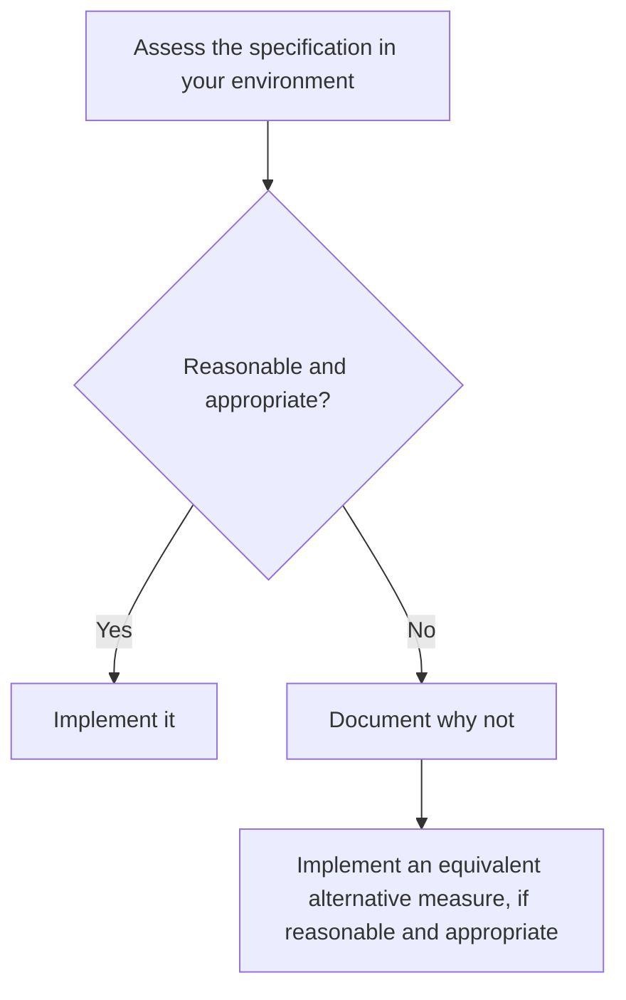

import AboutSample from '@site/src/components/AboutSample';

<AboutSample
  roles={['Policy and procedure writing', 'Security and audit compliance']}
  audience="Software engineers and engineering managers at a company that handles electronic protected health information as a covered entity or business associate. They know their systems and have not read the rule."
  goal="Let an engineer find the standard a control maps to, see whether the rule marks it Required or Addressable, and know what evidence the team is likely to be asked for."
  constraints="Every row is tied to a paragraph of the rule. Required and Addressable labels are copied from the rule text. Only primary sources. Not legal advice. Current as of the date on the page."
  tools="Markdown, Docusaurus, Mermaid, eCFR, the Federal Register and reginfo.gov as sources, Vale.">

- **A crosswalk, not a narrative.** Engineers come to this rule with a control in hand and ask "which requirement is this?". Tables in the rule's own order let them look it up and cite it.
- **The rule's labels and the practical reading sit in separate columns.** The first two columns restate the rule. The last column is my reading of typical ownership, and the page says so.
- **"Addressable" gets its own section and a flowchart.** It is the term readers most often get wrong, and the rule defines it as a short decision procedure.
- **The pending proposal is fenced off at the end.** The page describes the rule in force. Readers can see what is proposed without mistaking it for a current duty.

</AboutSample>

:::caution Writing sample, not legal advice
This page is a writing sample. It summarizes a federal rule in plain language and leaves out detail. It is not legal advice. Talk to a lawyer or your security official before you make a decision that depends on HIPAA.

**Checked against the rule text on November 10, 2026.**
:::

## Does it apply, and to what data?

The Security Rule is [45 CFR Part 164, Subpart C](https://www.ecfr.gov/current/title-45/subtitle-A/subchapter-C/part-164/subpart-C). A covered entity or business associate must comply with it for the electronic protected health information (ePHI) of a covered entity ([§ 164.302](https://www.ecfr.gov/current/title-45/section-164.302)).

The definitions are in [§ 160.103](https://www.ecfr.gov/current/title-45/section-160.103):

- A **covered entity** is a health plan, a health care clearinghouse, or a health care provider that transmits health information electronically in connection with a covered transaction.
- A **business associate** creates, receives, maintains or transmits protected health information on a covered entity's behalf, or provides certain services that involve it. The term includes a business associate's subcontractors that do the same.
- **Protected health information** is individually identifiable health information: it relates to a person's health, care or payment for care, and it identifies the person or could reasonably be used to. A few record types are excluded, such as employment records a covered entity holds as an employer.
- **ePHI** is protected health information transmitted by or maintained in electronic media.

**What this changes in your work:** the trigger is the data and your role, not your industry. A database row, a log line, a backup and a queue message can each hold ePHI.

## The general rules

You must ensure the confidentiality, integrity and availability of all ePHI you create, receive, maintain or transmit, and protect against reasonably anticipated threats and impermissible uses or disclosures ([§ 164.306(a)](https://www.ecfr.gov/current/title-45/section-164.306)).

The rule does not name products or algorithms. You may use any security measures that reasonably and appropriately implement the standards. In choosing, you must weigh your size, complexity and capabilities, your technical infrastructure, the cost of the measures, and the probability and criticality of the risks (§ 164.306(b)).

## What "addressable" means

Each implementation specification is marked Required or Addressable. You must implement a Required one (§ 164.306(d)(2)). For an Addressable one, § 164.306(d)(3) sets a procedure:

Addressable does not mean optional. It means you must assess, decide and, when you do not implement, write down why. The standard above the specification still binds you (§ 164.306(c)).

**What this changes in your work:** "we decided not to" needs a dated, written rationale tied to your risk analysis. An undocumented gap is not a decision.

## The safeguards crosswalk

In these tables, the first two columns restate the rule. The last column is a practical reading of what engineering teams commonly own, not a statement of law. "None" means the standard has no separate specifications, so the standard itself is the requirement.

### Administrative safeguards

Source: [§ 164.308](https://www.ecfr.gov/current/title-45/section-164.308).

| Standard | Implementation specifications | What an engineering team typically owns |
| --- | --- | --- |
| Security management process, (a)(1) | Risk analysis (Required). Risk management (Required). Sanction policy (Required). Information system activity review (Required). | System and data-flow inventory for the risk analysis. Tracked remediation work. A schedule for reviewing audit logs and access reports. |
| Assigned security responsibility, (a)(2) | None | Knowing who the named security official is and when to escalate. |
| Workforce security, (a)(3) | Authorization and/or supervision (Addressable). Workforce clearance procedure (Addressable). Termination procedures (Addressable). | Offboarding that removes access on the day someone leaves or changes role. |
| Information access management, (a)(4) | Isolating health care clearinghouse functions (Required). Access authorization (Addressable). Access establishment and modification (Addressable). | Role definitions, an approval trail for access requests, and periodic access reviews. |
| Security awareness and training, (a)(5) | Security reminders (Addressable). Protection from malicious software (Addressable). Log-in monitoring (Addressable). Password management (Addressable). | Malware protection on endpoints and build systems. Alerts on failed log-ins. Credential handling standards. |
| Security incident procedures, (a)(6) | Response and reporting (Required) | On-call runbooks, detection, mitigation, and a written record of each incident and its outcome. |
| Contingency plan, (a)(7) | Data backup plan (Required). Disaster recovery plan (Required). Emergency mode operation plan (Required). Testing and revision procedures (Addressable). Applications and data criticality analysis (Addressable). | Backups that produce retrievable exact copies. Restore procedures and tests. A ranking of services by criticality. |
| Evaluation, (a)(8) | None | Input to periodic technical evaluations, and a trigger for one when architecture or operations change. |
| Business associate contracts, (b) | Written contract or other arrangement (Required) | Telling the contract owner before a new vendor touches ePHI. See below. |

### Physical safeguards

Source: [§ 164.310](https://www.ecfr.gov/current/title-45/section-164.310).

| Standard | Implementation specifications | What an engineering team typically owns |
| --- | --- | --- |
| Facility access controls, (a)(1) | Contingency operations (Addressable). Facility security plan (Addressable). Access control and validation procedures (Addressable). Maintenance records (Addressable). | Any server room or office hardware you run. For hosted systems, knowing which provider's facilities hold your ePHI. |
| Workstation use, (b) | None | Rules for which devices may reach ePHI, and from where. |
| Workstation security, (c) | None | Managed laptops, screen locks, and limits on local copies of ePHI. |
| Device and media controls, (d)(1) | Disposal (Required). Media re-use (Required). Accountability (Addressable). Data backup and storage (Addressable). | Wiping or destroying disks and devices before disposal or re-use. Asset records. |

### Technical safeguards

Source: [§ 164.312](https://www.ecfr.gov/current/title-45/section-164.312).

| Standard | Implementation specifications | What an engineering team typically owns |
| --- | --- | --- |
| Access control, (a)(1) | Unique user identification (Required). Emergency access procedure (Required). Automatic logoff (Addressable). Encryption and decryption (Addressable). | No shared accounts. A documented emergency access path. Session timeouts. Encryption of stored ePHI and key management. |
| Audit controls, (b) | None | Logs that record activity in every system that contains or uses ePHI, and a way to examine them. |
| Integrity, (c)(1) | Mechanism to authenticate ePHI (Addressable) | Checksums, signatures or database controls that show data was not altered or destroyed without authorization. |
| Person or entity authentication, (d) | None | Authentication for users, services and API clients before they reach ePHI. |
| Transmission security, (e)(1) | Integrity controls (Addressable). Encryption (Addressable). | Encrypted transport between services, to clients and to vendors. |

**What this changes in your work:** both encryption specifications are Addressable in the current text. That gives you the § 164.306(d)(3) procedure, not a free pass. If you leave ePHI unencrypted anywhere, expect to show the written assessment.

## Documentation

You must keep your security policies and procedures in written form, which may be electronic. Where the rule requires an action, activity or assessment to be documented, you must keep a written record of it ([§ 164.316(b)](https://www.ecfr.gov/current/title-45/section-164.316)). Three specifications apply, all Required:

- **Time limit.** Keep the documentation for six years from the date it was created or the date it was last in effect, whichever is later.
- **Availability.** Make it available to the people who implement the procedures.
- **Updates.** Review it periodically, and update it when environmental or operational changes affect the security of ePHI.

**What this changes in your work:** a runbook or policy you replace today stays in the archive for six more years. Treat risk decisions, incident records and access reviews as records too.

## Business associate contracts

A covered entity may let a business associate handle ePHI only after it obtains satisfactory assurances that the business associate will safeguard it. A business associate owes the same step for its own subcontractors. The assurances must be in a written contract or other arrangement (§ 164.308(b)).

The contract must provide that the business associate will ([§ 164.314(a)](https://www.ecfr.gov/current/title-45/section-164.314)):

- Comply with the applicable requirements of the Security Rule.
- Bind any subcontractor that handles ePHI for it to the same requirements, by contract.
- Report to the covered entity any security incident it becomes aware of, including breaches of unsecured protected health information.

A security incident includes an *attempted* unauthorized access, not only a successful one ([§ 164.304](https://www.ecfr.gov/current/title-45/section-164.304)).

**What this changes in your work:** adding a hosting provider, a logging service or an analytics tool to an ePHI data path is a contract event, not only an architecture decision. Check that the agreement exists before data flows.

Breach notification has its own rules in [Subpart D](https://www.ecfr.gov/current/title-45/subtitle-A/subchapter-C/part-164/subpart-D). This page does not cover them.

## What may change

On January 6, 2025, the Department of Health and Human Services (HHS) published a notice of proposed rulemaking to revise the Security Rule ([90 FR 898](https://www.federalregister.gov/documents/2025/01/06/2024-30983/hipaa-security-rule-to-strengthen-the-cybersecurity-of-electronic-protected-health-information)). The comment period closed on March 7, 2025.

Among other changes, the proposal would:

- Remove the distinction between Required and Addressable specifications.
- Require encryption of ePHI at rest and in transit, with limited exceptions.
- Require multi-factor authentication.
- Require a written technology asset inventory and network map.

**Status as checked on November 10, 2026:** the proposal is still a proposal.

- The Federal Register lists no final rule and no withdrawal under the proposal's identifier, RIN 0945-AA22.
- The eCFR version history shows no change to the Subpart C section text since the proposal was published.
- The most recent [Unified Agenda entry](https://www.reginfo.gov/public/do/eAgendaViewRule?pubId=202510&RIN=0945-AA22) lists the rule as a long-term action, with final action projected for July 2027. Agenda dates are projections and often move.

HHS proposed that a final rule would take effect 60 days after publication, with compliance due 180 days after that. Recheck this page if HHS publishes a final rule.

## Sources

All statements about what the rule requires come from these primary sources.

- Security Standards for the Protection of Electronic Protected Health Information, [45 CFR Part 164, Subpart C](https://www.ecfr.gov/current/title-45/subtitle-A/subchapter-C/part-164/subpart-C) (eCFR), §§ 164.302 to 164.318.
- Definitions, [45 CFR 160.103](https://www.ecfr.gov/current/title-45/section-160.103) (eCFR).
- HHS, HIPAA Security Rule To Strengthen the Cybersecurity of Electronic Protected Health Information, notice of proposed rulemaking, [90 FR 898](https://www.federalregister.gov/documents/2025/01/06/2024-30983/hipaa-security-rule-to-strengthen-the-cybersecurity-of-electronic-protected-health-information) (January 6, 2025). A proposal, not law.
- Office of Information and Regulatory Affairs, [Unified Agenda entry for RIN 0945-AA22](https://www.reginfo.gov/public/do/eAgendaViewRule?pubId=202510&RIN=0945-AA22). Used for rulemaking status only.
