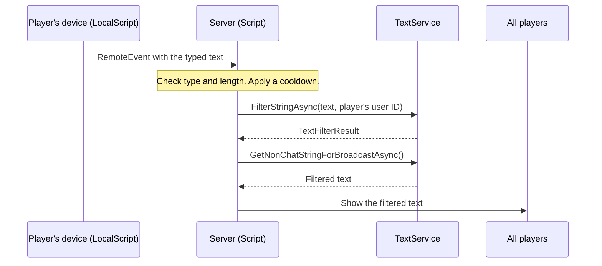

import AboutSample from '@site/src/components/AboutSample';

<AboutSample
  roles={['Trust and safety documentation']}
  audience="New Roblox creators who can write a short script and are adding their first feature that shows one player's words to another."
  goal="Explain the model behind text filtering so the steps in the tutorial make sense."
  constraints="Based only on the public Roblox Creator documentation. Every API statement links to its reference page. Unofficial: I do not work for Roblox."
  tools="Markdown, Docusaurus, Mermaid, the Roblox Creator documentation.">

- **Concept and task are separate pages.** A creator who already knows why filtering matters can go straight to the steps.
- **The diagram shows the trust boundary.** Most filtering mistakes come from doing the right thing in the wrong place, so the picture is about where code runs.

</AboutSample>

{/* DRAFT. Not published until Jordan has run the tutorial in Roblox Studio. */}

:::note Unofficial sample
This page is an unofficial writing sample. It is not affiliated with, endorsed by or reviewed by Roblox. It is based on the public [Roblox Creator documentation](https://create.roblox.com/docs/ui/text-filtering) as it read on November 10, 2026.
:::

## What you are responsible for

Roblox filters its own text chat for you. Text that your experience displays is different. The Creator documentation says you are responsible for filtering any displayed text that you do not have explicit control over, and that this covers anything a player can type: a sign, a pet name, a shop title ([Text filtering](https://create.roblox.com/docs/ui/text-filtering), [Safety](https://create.roblox.com/docs/safety)).

The same guide warns that an experience found to show unfiltered text can be removed until filtering is added.

## Where the filter runs

Filter on the server. A player's device runs your client scripts, and a player can change what those scripts send. The server is the only place you control.

Three things in this picture matter:

- **The client only asks.** It sends the text and never sets what other players see.
- **The server checks before it filters.** Anything can arrive on a RemoteEvent: a number, a table, or a string of ten thousand characters.
- **Only filtered text is shown.** The raw text is never stored or displayed.

## Which filter method to use

[`TextService:FilterStringAsync`](https://create.roblox.com/docs/reference/engine/classes/TextService#FilterStringAsync) takes the text and the user ID of the player who wrote it. It returns a [`TextFilterResult`](https://create.roblox.com/docs/reference/engine/classes/TextFilterResult). You then ask that result for a string, and the method you call depends on who will see it.

| Who sees the text | Method | Example |
| --- | --- | --- |
| Everyone in the server | `GetNonChatStringForBroadcastAsync()` | A message on a sign |
| One specific player | `GetNonChatStringForUserAsync(toUserId)` | A name shown to one user |

Do not use `GetChatForUserAsync`. The reference marks it as deprecated.

## When the filter fails

`FilterStringAsync` calls a Roblox service, so it can fail. The reference is direct about what to do: if it fails, do not display the text to any user, and do not retry, because the method retries internally.

In practice this means two rules:

- Wrap the call in `pcall`.
- On failure, show nothing. Never fall back to the unfiltered text.

## What filtering does not do

Filtering hides unsafe words. It does not stop a player from sending fifty messages a second, and it does not check that the text is a sensible length. Those checks are yours to write. The tutorial puts them in a small module with tests.

## Next step

- [Tutorial: add a sign that players can write on](./filtered-sign-tutorial.md)
