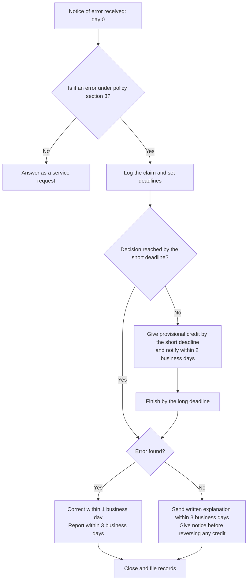

import Steps from '@site/src/components/Steps';

:::caution Writing sample, not legal advice
Fernhill Bank is fictional. This procedure is a writing sample and is not legal advice. See the [overview](./index.md) for what it is based on.
:::

| | |
| --- | --- |
| **Procedure number** | OP-114-01 |
| **Version** | 2.0 |
| **Effective date** | November 10, 2026 |
| **Procedure owner** | Dispute Operations Manager |
| **Implements** | [Policy CP-114](./policy.md) |
| **Used by** | Dispute Operations Analysts, front-line staff (steps 1 to 3) |

## When to use this procedure

Use this procedure when a consumer tells the bank, in any way, that something is wrong with an electronic transfer on their account.

## The clock

Every deadline runs from **day 0**, the day the bank first receives the notice of error. Day 0 is the day of the phone call, branch visit or message. It is not the day the claim reaches Dispute Operations.

Deadlines in **business days** skip days the bank is closed. Deadlines in **days** are calendar days.

## Deadlines at a glance

| Claim type | Short deadline (decide, or give provisional credit) | Long deadline (decide, if provisional credit was given) |
| --- | --- | --- |
| Standard | 10 business days | 45 days |
| New account: transfer within 30 days after the first deposit | 20 business days | 90 days |
| Point-of-sale debit card transaction | 10 business days | 90 days |
| Transfer not initiated within a state | 10 business days | 90 days |

## Steps

### Receive the claim

<Steps>

1. **Decide whether this is a notice of error.** Compare what the consumer describes with the list of errors in policy section 3.

   If it is a balance question, a request for a copy, or a request for tax records, handle it as a service request and stop here.

2. **Check the 60-day window.** Find the statement on which the transfer first appeared, and the date the bank sent it. Record both.

   If the notice arrived more than 60 days after that date, do not reject the claim. Log it, mark it **Late notice**, and send it to the Dispute Operations Manager.

3. **Log the claim in the dispute system on day 0.** Record:

   - The consumer's name and account number.
   - The date and time of the notice, and how it arrived.
   - The type, date and amount of each transfer in question.
   - Why the consumer believes there is an error, in their words.

   If you took the notice by phone or in a branch, you may ask the consumer to confirm it in writing within 10 business days. Tell them now, and give them the address. Record that you did. Do not wait for the confirmation before you go on.

</Steps>

### Investigate

<Steps start={4}>

4. **Set the deadlines.** Choose the claim type from the table above. The dispute system sets the short and long deadlines from day 0. Check that both dates are correct.

5. **Investigate.** Review the bank's own records for the transfer first. Where the transfer involved a merchant, an ATM network or another institution, ask them for records the same day.

   **On business day 8, check progress.** If you will not reach a decision by the short deadline, ask the Dispute Operations Manager to approve the extended time limit. Then:

   - Credit the full disputed amount to the account, with any interest, no later than the short deadline.
   - Within 2 business days of the credit, send letter **DL-02 Provisional credit**. It states the amount and date and says the consumer has full use of the funds.

   If the bank asked for written confirmation and has not received it within 10 business days, ask the manager whether to give provisional credit. Record the decision and the reason.

6. **Decide.** State whether an error occurred, which error, and in what amount. Record the evidence you relied on. A second analyst reviews any decision of **No error** before it is final.

</Steps>

### Resolve and close

<Steps start={7}>

7. **If an error occurred, correct it within 1 business day of the decision.**

   - Credit or debit the account for the amount of the error. Make any provisional credit final.
   - Refund fees and add interest that the error cost the consumer.
   - Within 3 business days of completing the investigation, send letter **DL-03 Error corrected**.

8. **If no error occurred, or a different error occurred, explain in writing within 3 business days of completing the investigation.** Send letter **DL-04 Findings**. It must:

   - Explain what the bank found and why.
   - Tell the consumer they may ask for copies of the documents the bank relied on.

   If the bank gave provisional credit, the letter must also state the date and amount of the debit. It must say that for 5 business days after the notice, the bank will pay checks, drafts and preauthorized transfers it would otherwise have paid, with no overdraft fee.

   If the consumer asks for the documents, send them promptly.

9. **Close the claim.** Attach the notice, the evidence, each letter and the decision record. The dispute system keeps closed claims for at least 2 years. Do not delete a claim that is under a legal hold.

</Steps>

## If the consumer raises the same error again

When the bank has completed this procedure for an error, it does not have to investigate the same error a second time (12 CFR 1005.11(e)). There is one exception: the first claim was a request for documentation or information, and the consumer now reports an error based on what they received.

Tell the consumer the earlier result. If they give new facts, log a new claim.

## Escalate when

| Situation | Send to |
| --- | --- |
| A deadline will be missed, or was missed | Dispute Operations Manager, the same day |
| Notice arrived after the 60-day window | Dispute Operations Manager |
| The consumer may be a victim of fraud or exploitation | Fraud team, in addition to this procedure |
| The consumer mentions a lawyer or a regulator | Compliance |

## Revision history

| Version | Date | Change | Approved by |
| --- | --- | --- | --- |
| 2.0 | November 10, 2026 | Added the day 8 progress check. Added second-analyst review of **No error** decisions. | Dispute Operations Manager |
| 1.0 | November 12, 2025 | First issue. | Dispute Operations Manager |
