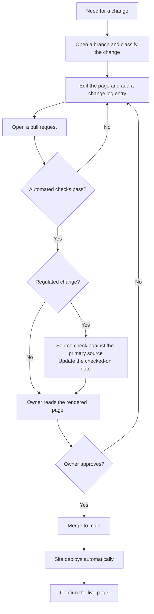
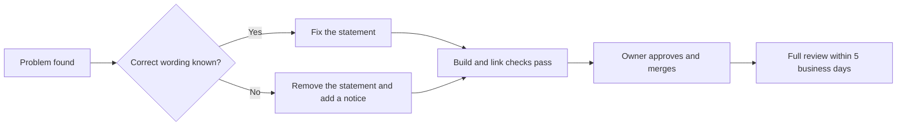

import AboutSample from '@site/src/components/AboutSample';

<AboutSample
  roles={['Regulated product documentation', 'Security and audit compliance', 'Policy and procedure writing']}
  audience="Anyone who changes a page on this site, and reviewers who want to see how I control changes to documents that readers rely on."
  goal="Make every change traceable: who changed what, why, what was checked, and when it went live."
  constraints="This is the real process for this site, so it only describes controls that exist in the repository. It is sized for a small docs set with one owner."
  tools="Git, GitHub pull requests and Actions, Vale, lychee, a reading-level script, Mermaid.">

- **Changes are sorted by risk, not by size.** A one-word edit to a deadline in a legal summary is riskier than a new page of background. The class of a change decides what gets checked.
- **The fast track skips waiting, not checking.** An urgent fix can go live before the full review, but the build and link checks still run and the full review still happens afterward.
- **"Unpublish" is a valid fix.** When a safety or legal statement is wrong and the right wording is not yet known, removing the statement is safer than leaving it up.
- **Dates on regulated pages are part of the content.** A legal summary without a "checked on" date cannot be trusted, so the date is a required field.

</AboutSample>

This is the working process for the pages under `/docs` on this site. The source is the public repository [kopyk/portfolio](https://github.com/kopyk/portfolio).

## Roles

This site has one writer, so one person holds more than one role. The roles stay separate so that each check has a name.

| Role | Who | Responsible for |
| --- | --- | --- |
| **Document owner** | Jordan Yan | Decides what each page says. Approves every change. |
| **Author** | Whoever opens the pull request | Makes the change, classifies it, and completes the checklist. |
| **Source checker** | The document owner | Re-reads the cited primary source for any change to a regulated statement. |
| **Automated checks** | GitHub Actions | Build, internal links, external links, prose style, reading level, code tests. |

## Classify the change

Every change belongs to one class. If a change fits two, use the higher one.

| Class | What it covers | Extra checks beyond the standard ones |
| --- | --- | --- |
| **Minor** | Spelling, formatting, a broken link. No change in meaning. | None |
| **Standard** | New or changed content that is not a regulated statement. | Read the rendered page from start to end |
| **Regulated** | Any statement of what a law or rule requires. Any instruction in the family safety guides. | Source check. Update the "checked on" date. For guardian pages, the reading-level check must pass. |
| **Urgent** | A live safety instruction or legal statement is wrong or out of date. | Follows the [fast track](#fast-track-for-urgent-changes) |

## Standard workflow

1. **Open a branch.** Name it for the change, for example `fix/coppa-penalty-figure`.
2. **Make the change.** Follow the [writing-for-translation guide](./writing-for-translation.md).
3. **Add a change log entry** to [`CHANGELOG.md`](https://github.com/kopyk/portfolio/blob/main/CHANGELOG.md). State the class, the pages changed and the reason.
4. **Open a pull request.** State the class in the description.
5. **Wait for the automated checks.** Fix anything that fails. Do not turn a check off to get a pass.
6. **For a Regulated change, do the source check.** Open the cited section of the law or rule. Confirm that the changed sentence still matches it. Update the "checked on" date on the page.
7. **Approve and merge.** The owner reads the rendered page, then merges.
8. **Confirm the live page.** After the deploy finishes, open the page on the live site and check the change.

## What the automated checks cover

| Check | Tool | Fails when |
| --- | --- | --- |
| Build | Docusaurus | The site does not build, or an internal link or anchor is broken |
| External links | lychee | A link to another site does not resolve |
| Prose style | Vale, with the rules in [`styles/Portfolio`](https://github.com/kopyk/portfolio/tree/main/styles/Portfolio) | A page breaks a style rule at error level |
| Reading level | [`scripts/reading-level.mjs`](https://github.com/kopyk/portfolio/blob/main/scripts/reading-level.mjs) | A family safety page scores above grade 8 |
| Tutorial code | Luau | A test for the creator tutorial's module fails |

## Versioning and the change log

- **Git is the version history.** Every published state of every page is a commit on `main`.
- **The change log is the readable history.** It lists changes by date, newest first, with the class of each.
- **Sample documents that carry their own version number** (the policy and the procedure) also keep a revision table on the page, because their readers would not look in a repository.
- **Each page shows when it was last updated.** The date comes from Git.

## Fast track for urgent changes

Use the fast track when a live page gives a safety instruction or a legal statement that is wrong, and a reader could act on it.

1. **Act within 1 business day** of finding the problem.
2. **Fix or remove.** If you know the correct wording and can cite its source, fix the statement. If not, remove it and add a notice that the section is under review.
3. **Run the build and link checks.** These are never skipped. Style and reading-level findings may wait for the full review.
4. **Merge and confirm the live page.**
5. **Log it.** Mark the change log entry **Urgent** and say what was wrong.
6. **Complete the full review within 5 business days.** Do every step of the standard workflow that the fast track skipped. Record the result in the change log.

## Scheduled reviews

| Pages | When | What to check |
| --- | --- | --- |
| Compliance explainer | Each January, and when the rule is amended | The penalty figure. The current rule text against each cited section. |
| Policy and procedure set | Every 12 months | Each deadline against the regulation. |
| Family safety guides | Every 6 months | Steps still agree across the five pages. Reading level. |
| All pages | Every 6 months | External links. The "about this sample" note still matches the page. |
